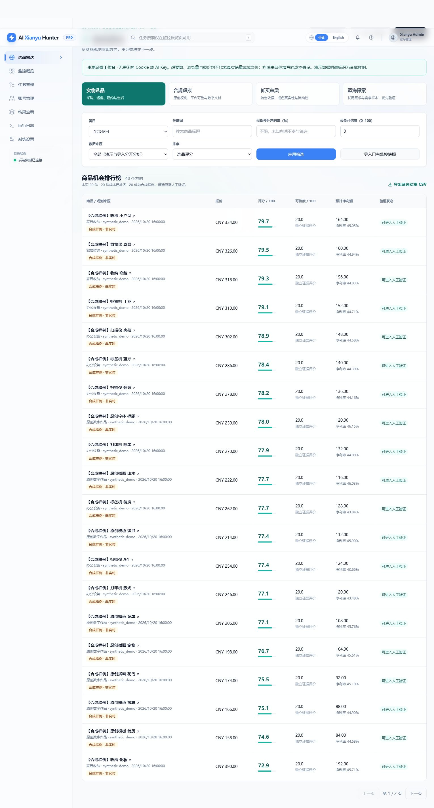
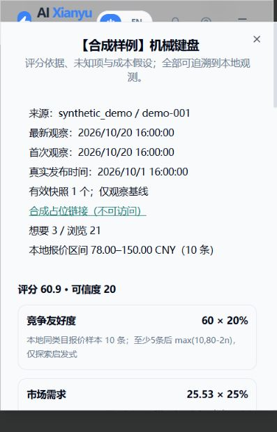

# 闲鱼商机雷达 P0 使用与交付说明

## 用途与边界

这是个人本地选品工作台：将你合法取得的商品报价与观测整理、去重、比较，帮助挑选值得进一步验证的方向。
保留原项目的任务监控、账号管理、AI 分析、结果、价格历史和 Docker 构建能力。
P0 使用确定性规则，无 Cookie、无 AI Key 时也可完成全部离线流程。

四种模式都可运行：实物重点看采购与交付；合规虚拟额外要求权利授权、平台可售性、数字交付依据；转售额外要求参考价与验真依据；蓝海提高需求和竞争维度权重，并明确提示样本稀少不等于蓝海。
切换模式会重新计算同一批观测的评分和核验项。模式不替你确认商品可售性，也不会执行购买、上架、客服或发货。

## 启动与首次体验

Python 3.10+、Node.js 20.19+ / 22.12+。沿用现有 requirements 与 npm lockfile，无新增第二套服务。

```powershell
# Windows，仓库根目录
python -m venv .venv
.\.venv\Scripts\python -m pip install -r requirements.txt
cd web-ui
npm ci
npm run build
cd ..
.\.venv\Scripts\python -m uvicorn src.app:app --host 127.0.0.1 --port 8000
```

已安装的 Windows 环境可用 `start-radar.ps1` 再次启动。端口已占用时先关闭原服务，或将命令端口改为 8001。
前端正式构建直接输出根目录 `dist/`，由原 FastAPI 服务提供；开发时仍可使用原 Vite 代理。
打开 `http://127.0.0.1:8000/opportunities`。默认 Web 账号 `admin/admin123`，可通过 `.env` 的 `WEB_USERNAME`、`WEB_PASSWORD` 修改。
本机演示不要求 `.env` 或采集登录态。真实 AI 分析另需原有模型配置，真实监控另需合法有效的登录态与浏览器。

1. 点击“载入合成演示”。应提示接受 41 行、新商品 40、重复身份 1、拒绝 1。
2. 再点一次：新商品与新快照均为 0。不会把首次扫描记录为“新上架”，也不产生“成交”事件。
3. 尝试四种模式，用“关键词=键盘”筛选出 10 件。演示数据统一标为 `synthetic_demo`，不代表任何真实市场。
4. 点商品标题，查看六维证据、可信度、风险、缺失项、首次与最新观察时间。相似标题只提示疑似重复，不合并规格或成色。
5. 输入明确的成本与核验说明，点击“保存假设并重新评分”。未知留空，确认为零才填 0。币种沿用商品币种。
6. “纳入候选池”保存在 `experiments`，表示准备人工验证；不会执行外部交易。
7. “导出筛选结果 CSV”导出当前筛选的全部结果，含评分、利润和否决项。导出列与原始导入列不同，报告不能直接当成原始数据重复导入。
8. “导入已有监控快照”读取原 SQLite 的 `result_items` 与 `price_snapshots`，一次最多 500 条（API 可设 1000）。不发网络请求。
9. “类目与发现”新增或编辑类目与种子词，再离线扩词、生成发现待办。界面显示最近 200 个词；API 保存每个词的来源和发现时间。

## CSV 格式

UTF-8（支持 BOM），第一行为英文表头。使用标准 CSV 引号转义逗号/换行。
必需列 `source,source_item_id,title,observed_at`。原始模板见 `src/resources/opportunity_demo.csv`。

```csv
source,source_item_id,title,price,currency,category,observed_at,want_count,source_confidence
manual_fixture,example-001,合成测试机械键盘,80.00,CNY,电脑外设,2026-10-20T16:00:00+08:00,,0.5
```

上行仅为格式示例，不是市场数据。真实闲鱼数据请使用一致的 `source=goofish` 和真实、稳定的商品 ID，以便与原监控快照去重。
`synthetic_demo` 是演示来源命名空间，不应用于真实数据。

| 字段 | 说明 |
|---|---|
| source / source_item_id | 硬去重键，来源相同且商品 ID 相同才合并身份 |
| url | 可选 HTTP/HTTPS 来源链接，导入不会访问此链接 |
| title / category | 标题 / 已配置类目；缺省类目“未分类”，按已配置种子词最长匹配尝试分类，无匹配仍未分类 |
| price / currency | 观测报价 / 三位大写币种（缺省 CNY），金额非负、最多两位小数；报价未知可留空 |
| observed_at | 必需，带时区 ISO 时间；不得为未来 |
| listing_created_at | 可选真实发布时间；不得用首次观察时间补造，不能晚于观察时间 |
| seller_id / condition | 可缺失；卖家昵称不当作稳定 ID |
| want_count / view_count | 可缺失、非负整数；仅兴趣信号，不推断销量 |
| source_confidence | 0–1 的来源质量自评，缺省 0.5；用户提供，不表示系统独立核实过 |
| raw_metadata | 可选 JSON 对象，用于保存来源依据，不填 Cookie 或密钥 |

成本列可选：`expected_sale_price,purchase_cost,shipping_cost,platform_fee,fulfillment_cost,expected_loss,resale_reference`。
核验说明列可选：`evidence_note,supplier_evidence,delivery_evidence,rights_evidence,platform_evidence,resale_evidence,authenticity_evidence,differentiation_evidence`。
这些值都是用户输入的假设和说明，系统没有核实供应商、平台费率、授权或真实成交。
CSV 中不提供成本时保留已有成本；相同观测重复导入也保留人工编辑后的成本。新增较新快照携带成本时会更新当前假设。

单次上限 2 MB / 1000 行，P0 商品总量上限 10000。未知列、重复表头、无时区、未来时间、负金额、非有限数字、非法 JSON 会报错。
行级错误显示行号并写入 `opportunity_imports`；整个 CSV 语法/表头错误返回 400，输入模型错误返回 422。
同一身份币种改变须人工核实，不会自动进行汇率换算。旧快照可补历史，但不会覆盖较新商品价格与成本。
同一时刻不同内容保留修订快照，没有把快照次数当作销量或上新数量。

## 评分与可信度

每维 0–100，总分为各维得分乘权重后求和，再四舍五入到两位。所有公式为探索启发式，未经真实转化实验校准。

| 模式 | 需求 | 利润 | 竞争 | 履约 | 风险 | 差异化 |
|---|---:|---:|---:|---:|---:|---:|
| 实物 physical | 25 | 25 | 20 | 15 | 10 | 5 |
| 虚拟 virtual | 25 | 20 | 15 | 15 | 20 | 5 |
| 转售 resale | 20 | 30 | 15 | 15 | 15 | 5 |
| 蓝海 blue_ocean | 30 | 15 | 25 | 10 | 10 | 10 |

- 需求：`min(85, log(1+想要数)/log(101)×85)`；未知为 0 分，原始值仍为 null。
- 利润：`min(100,max(0,净利率百分数×2))`。净利润 = 预计成交价 − 采购 − 运费 − 平台费用 − 履约 − 损耗。采用 Decimal；六项任一未知则利润及净利率均为 null，售价为 0 时净利率也为 null。
- 竞争：本地同来源、同币种、同类目样本至少 5 件后 `max(10,80-2×样本数)`；样本不足或未分类为 0。只表示本地报价样本密度，不能解释为平台全量竞争或同成色估价。
- 履约：货源及交付说明均填写为 80，否则 0。
- 风险：标题命中疑似禁售词为 0，否则 `max(0,85-20×否决/待核验项数)`；规则词表仅基础检查，不能视为完整合规判定。
- 差异化：填有差异化依据为 70，否则 0；不表示该依据已经验证。

缺少货源、报价异常、疑似侵权/不可售、未知利润或非正利润会被标记 `blocked`；虚拟与转售模式额外检查其专属字段。
有否决项时永远不会输出优先验证建议。只有无否决项、非合成来源、总分至少 75 且可信度至少 70 才可为 `priority_validation`；这是人工验证优先级，不保证销售或收益。

独立可信度 = `100 × source_confidence × 关键字段覆盖率 × 时效系数`。
覆盖率含报价、想要、浏览、稳定卖家 ID、发布时间、完整成本、成本依据、货源、交付与至少 5 条同类目样本；虚拟/转售再加入专属证据字段。
7 天内时效 1，8–30 天 0.7，超过 30 天 0.4。演示来源可信度最高 20。
排名查询会刷新当前时效评分；`POST /score` 可保存六维权重，要求键完整、非负且总和为 100，后续刷新继续使用保存的权重。

## 数据、API 与鉴权

复用 `APP_DATABASE_FILE`，默认 `data/app.sqlite3`。新增表由现有 `init_schema` 的幂等迁移创建，不删改原任务、结果、价格表。
迁移增加 `categories,keyword_seeds,opportunity_items,opportunity_observations,opportunity_scores,cost_assumptions,experiments,opportunity_imports,discovery_jobs`。
默认类目和词仅首次初始化，后续启动不覆盖用户维护。备份数据库应停止服务后复制 SQLite 主文件，或使用 SQLite backup 接口。

新 `/api/opportunities` API 需原 `WEB_USERNAME/WEB_PASSWORD`：登录原 `POST /auth/status` 后返回 HttpOnly、SameSite=Strict、8 小时 Cookie；HTTPS 请求使用 Secure 属性。
API 客户端可直接显式发送 HTTP Basic 凭据。未登录返回 401，由 Vue 跳转原登录页，不弹浏览器 Basic 对话框。
Cookie 签名密钥为进程内随机值，服务重启或 Web 凭据变更后需重新登录。P0 用单进程 Uvicorn，不支持多 worker 共享此会话。
`POST /auth/logout` 清除新 Cookie；登录密码不会写到前端存储。原有 API 的鉴权行为没有批量重构；对外部署应沿用受控访问与 HTTPS。

| 方法和路径（统一前缀 `/api/opportunities`） | 行为 |
|---|---|
| GET 空路径 | 排行榜；strategy/category/q/min_confidence/min_margin/source_scope/sort/page/limit |
| GET /{id}?strategy=physical | 详情、最新100条快照、疑似重复、证据和假设 |
| POST /import | JSON `{ "content": "CSV文本" }`，逐行报告 |
| POST /demo | 导入内置合成样例，可重复执行 |
| POST /import-existing?limit=500 | 复用原 SQLite 监控结果及价格快照，无网络 |
| GET /imports | 最近50次导入与异常原因 |
| POST /score | JSON `{ "strategy": "physical", "weights": {...可选...} }` |
| PUT /{id}/costs | 完整替换该商品的当前成本假设并刷新四种评分 |
| POST /{id}/candidate | JSON `{ "strategy": "physical" }`，候选池幂等入池 |
| GET /export | 同排行榜筛选，导出全部匹配项，防 CSV 公式注入 |
| GET /categories、PUT /categories | 类目读取/保存；JSON name/parent/keywords |
| GET /keywords、POST /keywords/expand | 最近200个关键词及离线扩展 |
| GET /discovery、POST /discovery | 人工待办查询/规划；JSON budget/breadth_ratio |

分页每页最多 100，排序白名单 score_total/confidence_score/net_margin/observed_at，默认总分降序；同分按商品 ID，确保翻页稳定。
`source_scope=demo/imported/all`。开启净利率门槛会排除利润未知商品，来源/币种互不混算，合成数据不参与真实来源的价格与竞争样本。

发现默认广度/深挖 40/60，可配置；单次最多 50、总待办最多 200、词库最多 5000。
扩词扫描最多200个当前种子词和500个最近标题；标题扩词保留商品/种子 ID 依据，不声称存在搜索量。
P0 队列固定 `pending_manual`，无联网执行器。真实平台请求只通过原有采集器；后续接入发现任务前必须复用限速、失败熔断和人工处理机制，遇人机验证或访问限制停止，不能借队列绕过限制。

## Docker 与兼容性

原 Dockerfile 直接 `COPY src`，包含 `src/resources/opportunity_demo.csv`。没有增加 Python/Node 之外的新基础设施。
需从本分支源码构建才能获得雷达；原 compose 默认拉取上游镜像，不会自动包含 Fork 的变更。

```bash
docker build -t ai-goofish-radar:local .
docker run --rm -p 127.0.0.1:8000:8000 -v "${PWD}/data:/app/data" ai-goofish-radar:local
```

原监控任务、AI 分析、调度器和部署入口保留。修复 Windows 输出流 detach 导致 pytest 捕获崩溃；失败保护改为稳定侧锁文件并在 Windows 使用文件锁，避免打开数据文件时原子替换失败。
移除与既有构建路径测试冲突的 `.dockerignore` 旧条目，添加 Windows 时区依赖。

## 实际验证记录（2026-10-21）

Fork 基线与上游均为 `77f8d75869acd65f9dba72731b95c7c49ea67bdf`，分支 `feat/opportunity-engine-mvp`。
环境 Windows / Python 3.12.10，后端安装自 requirements；FastAPI 0.154.0、Pydantic 2.14.1、pytest 9.1.1。前端按原 npm lockfile 安装，Vite 7.3.0。

- 基线 `PYTEST_DISABLE_PLUGIN_AUTOLOAD=1 pytest` 在 Windows 被原有 stdout.detach 破坏捕获；补依赖并用 `-s --basetemp=.test-runs/baseline-complete` 得到 **122通过、6失败、3跳过**。原失败为两项 Windows 失败保护、Docker ignore 检查、两项大小写环境测试、旧结果返回字段断言。
- 已修复失败保护和输出流；环境测试使用显式大小写敏感映射覆盖双键场景；结果测试验证实际持久化字段及可见性元数据，未删除行为检查。
- 新增评分和选品集成测试覆盖利润、缺失、风险、四模式、认证、分页/过滤、导入异常、去重、历史观察、首次基线、原监控适配、类别/词库/有界队列、权重、候选池、导出及数据隔离。
- 最终后端 **165通过、3跳过、0失败**（新增选品用例37项），`npm run build` 类型检查与生产构建通过。额外验证重复 CSV 不覆盖人工成本，以及非有限 JSON 元数据拒绝且无残留写入。
- 全部默认测试不启用真实闲鱼流量；live 测试仍需用户主动设置 `RUN_LIVE_TESTS=1`。
- 前后端实际测试最终结果见 PR；本地可复现命令如下。Windows 默认临时目录存在权限问题时指定仓库内临时目录。

```powershell
New-Item -ItemType Directory -Force .test-runs | Out-Null
$env:PYTEST_DISABLE_PLUGIN_AUTOLOAD='1'
.\.venv\Scripts\python -m pytest --basetemp=.test-runs/verification
cd web-ui
npm ci
npm run build
```

浏览器交互验收：原登录 → 合成 CSV 入库40件 → 上传同一 CSV（新增0/新快照0）→ 四模式 API / 页面切换 → 键盘关键词10条 → 修改采购成本并重新评分 → 候选池持久化 → 筛选报告 CSV 下载 → 离线扩词 → 40/60 队列10条。
窄屏内置浏览器完成表单交互；桌面 Chrome 用于截图查看。发现的未登录 Basic challenge 阻塞已修复。Chrome 自动化会话点击未响应的问题在独立浏览器未复现。
Docker CLI 已安装，但本机 Docker Desktop 引擎未启动，因此没有宣称完成镜像构建/容器启动实测。npm ci 报告基线依赖存在20项审计告警，本次未执行无关的破坏性依赖升级。




## 参考项目与许可证

保留主仓库 MIT LICENSE 与原作者版权。参考了以下公开设计概念，未复制第三方源代码或把多个项目拼接：

- [xianyu-ops](https://github.com/weiyinerzui/xianyu-ops)：市场评分、需求证据与长尾词方向；未确认其源码复用许可，仅参考 README 概念。
- [xianyu-radar](https://github.com/djzhhil/xianyu-radar)：首次观察基线、快照与候选验证边界；未确认其源码复用许可，仅参考公开说明。
- [xianyu-demand-operator](https://github.com/122267881/xianyu-demand-operator)：风险否决、少量候选实验；其 LICENSE 为 MIT，本次没有引入其源码。

## 下一阶段

P1：通过原采集器进行有限预算、限速、异常即停且可人工接管的长期观测；细分规格/成色可比样本、供货报价核验、商家池与完整快照差分。
P2：人工候选实验与真实成交/退款复盘，校准目前尚未验证的评分权重和需求假设。
P3：用户逐次授权后的上架草稿、客服和履约集成。
本次未实现全平台全量抓取、真实成交数据采集、第三方供应链核验、自动发布或自动交易；规则词表也不替代人工规则审查。
