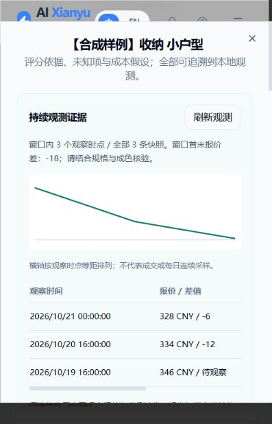
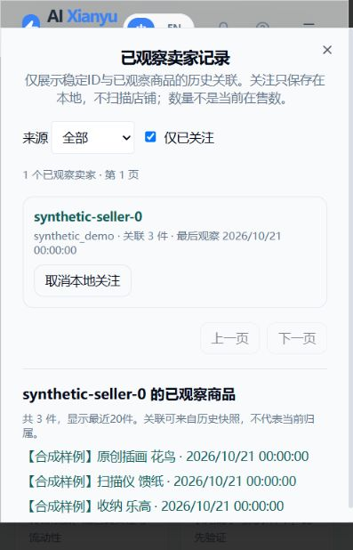

# P1 第一阶段：持续观测与卖家记录

在 P0 的 CSV → SQLite → 评分 → 排行榜闭环上，增加本地监控数据的连续投影及可追溯变化。
启动、账号、导入格式和评分规则沿用 [P0说明](OPPORTUNITY_P0.md)。本阶段不新增浏览器采集器、不增加平台请求、不扫描卖家店铺。

## 现在可以做什么

1. 打开 `/opportunities`，原 Web 账号登录后可见“持续观测”面板。
2. 原有监控任务照常写入 `result_items` 和 `price_snapshots`；现有 APScheduler 每60秒读取两表各最多100条，保存增量游标，进入统一选品结构并重新评分。
3. 点“同步一批”可提前处理一批；待处理数非零时会按批继续追赶。点“暂停同步”可停止本地投影，原监控任务不受影响；恢复也只恢复本地读取。
4. 点“载入合成演示”得到基础40件商品，再点“载入变化演示”增加80条合成历史快照。反复载入新增快照为0。若已使用P0演示，直接载入变化演示即可。
5. 打开商品详情，在“持续观测证据”查看窗口内时点、报价图、相邻报价差、想要数与浏览量差值。
6. 打开“卖家记录”，查看按稳定卖家ID归组的已观察商品；可本地关注并使用“仅已关注”筛选，点关联商品进入其详情。

页面可见时每60秒刷新本地同步状态，检测到新的处理时间后刷新排行榜；离开页面会清除刷新定时器。历史弹窗可点“刷新观测”获取最新记录。

## 数据边界

- 首次有效观察仅建立基线，不产生“上新”“售出”事件。
- 同一时间的多份修订按最后保存版本展示，并注明修订次数；没有伪造多个时间点。较晚导入的旧记录按观察时间排序，不覆盖最新报价。
- 原始观测中的未知值保留为null。新价格快照没有想要数/浏览量时，不把旧计数移到新日期充当新测量；差值显示“待观察”。
- 计数下降会显示可能重置或修正的提示，不解释为负销量。没有任何销量或成交量推断。
- 报价图按观察时点等距绘制，并注明不是每日连续采样；缺失报价不连线。标题或成色改变时提示人工核验可比性。
- 默认展示最近100条快照；API最多500条，截断会显式标记。窗口首末报价差仅比较实际保留窗口的首末已知报价，缺失则为空。
- 原采集器的按页价格快照没有完整店铺扫描证明，因此 `scan_completeness=unknown`。本阶段不生成“商品消失”“店铺上新”“当前在售数”等需要完整扫描的结论。
- 卖家记录只使用明确观察到的稳定ID。旧记录只有昵称时不推断ID；后续价格记录缺少卖家ID时，历史关联仍可追溯，但不会补造成当前归属。
- 来源不同的同名卖家ID分别统计、分别关注；合成来源与真实导入可分开筛选。

所有演示快照、卖家、价格和兴趣计数都是合成数据。当前记录支持探索验证，不替代真实成交、退款或供应商核验。

## 同步、迁移与故障处理

复用主 SQLite、现有初始化与 APScheduler。原监控采集代码和调度任务保留，没有新增第二个任务调度器。
刷新原任务调度时会重新注册本地同步任务，限制 `max_instances=1` 并合并错过的执行；同库事务确保手动与自动同步不会重复消费。
游标按源表递增主键维护，分别读取，避免监控结果较多时饿死价格历史。启动后从最早尚未处理的行开始补齐，而非只取最近500条。

新增：

- `price_snapshots.opportunity_metadata_json`：今后保存当次想要数、浏览量、稳定卖家ID、成色这几个白名单字段；旧数据保留默认 `{}`，不回填未知计数。
- 原商品详情处理中已取得的卖家ID保存到结果记录。没有增加卖家网络请求。
- `app_metadata` 中的 `opportunity_sync:*`：两表游标、启用状态、上次处理时间、错误及待重算标记。
- `opportunity_sync_rejections`：无有效商品ID、异常时间、错误数据形状等问题行的来源/行ID/原因。保留原数据，游标继续；不会无限重试同一个坏行。
- `opportunity_seller_watches`：按来源和卖家ID保存本地关注状态及可选备注。

同步只复制商品白名单字段与表名/行ID等来源依据，不复制Cookie、完整卖家资料或原始响应。
无时区的原监控观察时间按 Asia/Shanghai 解释，并在来源依据明确标注；原发布时间文本仍标为未核验，不自动当成发布时间。
真实闲鱼商品同步要求有效数字商品ID，URL、未知ID、昵称都不能作为硬去重身份。

异常处理：

- 单行数据无效：记录拒绝原因，不补造值。可通过明确来源和商品ID的CSV补充正确观测。
- 商品容量达到10000：暂停同步，不跳过触发容量限制的源行；处理容量问题后显式恢复。
- 非预期写入异常：回滚当前批次，持久化暂停状态，等待人工检查后恢复。
- 观测已入库但评分失败：保留待重算标记并暂停。恢复后，即使没有新源行，也会先修复评分。
- 若SQLite本身不可访问，暂停状态也可能无法落库；日志保留异常，调度仍最多每60秒尝试一次本地操作，不会发起平台请求。原监控的数据存储故障需一并处理。

没有自动执行发现任务、登录重试、验证码处理或账户轮换。真正的在线扫描、完整性标记和人工接管流程仍属于后续P1工作。

## API

沿用新选品API的鉴权：原Web登录Cookie，或显式HTTP Basic。以下均以 `/api/opportunities` 为前缀。

| 方法与路径 | 行为 |
|---|---|
| GET /sync | 启用状态、两个游标、待同步数、上次处理、异常与最近20条拒绝原因 |
| PUT /sync | JSON `{"enabled": false}` 暂停；`true` 显式恢复 |
| POST /sync/run | 同步一批；暂停时不消费数据，非预期异常返回503 |
| GET /{id}/history?limit=100 | 价格、兴趣计数、相邻变化、修订/缺失提示；最多500条 |
| POST /demo-history | 为40件基础演示商品加载80条历史快照；幂等 |
| GET /sellers | source_scope=all/demo/imported、watching_only、page/limit（最多100） |
| GET /sellers/{source}/{seller_id} | 已观察关联商品分页，最多100/页 |
| PUT /sellers/{source}/{seller_id}/watch | JSON `{"watching":true,"note":"可选备注"}`；仅允许已有ID证据的卖家 |

`history.sales_count` 始终为null，表示未知而非0。关注只落本地表，不安排任何店铺采集。

## 实际验证（2026-10-21）

基线：P0 `dee049cec92276bc298a8e3b6cd5b1a030288010`，后端165通过/3跳过，前端构建通过。
本批新增15项集成测试；最终全量 **180通过、3跳过、0失败**，`npm run build` 类型检查和生产构建通过。

覆盖：两表限额与断点、旧记录回补、稀疏计数、幂等、暂停恢复、异常回滚、评分失败恢复、容量背压、快照字段白名单、老表迁移、合成三时点、同时间修订、计数下降、卖家历史关联、来源隔离、鉴权与调度重注册。
测试默认使用隔离SQLite与Fixture，不访问真实闲鱼。

浏览器实测：暂停→恢复、变化演示重复加载、三时点报价图与差值、13个合成卖家、本地关注→仅已关注1个→关联商品列表；浏览器未报告JS错误。
本机服务已启动于 `http://127.0.0.1:8000/opportunities`。Docker引擎未启动，未追加容器运行实测声明；迁移及样例位于现有src目录，会随原Docker源码构建包含。

## 后续P1

在原采集器上补齐受限预算的完整扫描、任务失败即停与统一人工接管；再增加卖家完整目录的可信差分、供货报价核验。采集前需用户提供有效的闲鱼登录态；不进行登录/验证码规避。
本批交付的是P1的本地连续观测基础，不宣称已完成全平台自动探索或店铺完整扫描。
