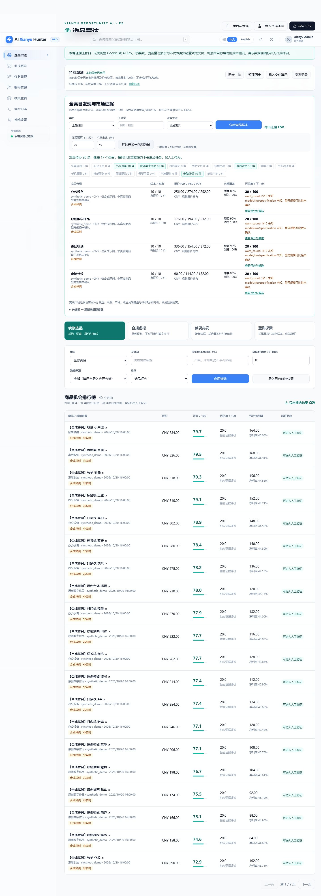
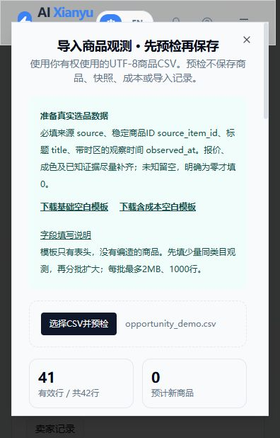
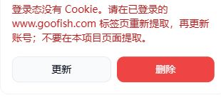
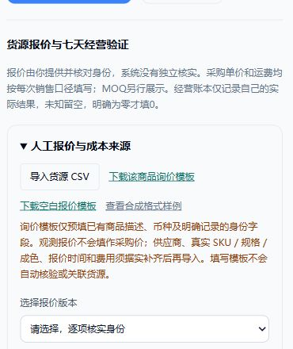

# P2 全类目选品、货源与人工实验

沿用 [P0](OPPORTUNITY_P0.md)、[P1](OPPORTUNITY_P1.md) 的 FastAPI、Vue、SQLite、登录与启动方式。访问 `/opportunities`。

## P2A：离线发现与市场证据

1. 载入合成演示或导入已获许可的商品 CSV。
2. “全类目发现与市场证据”设置预算和广度占比，点击“扩词并公平规划类目”。默认40/60保持不变，每次最多50条，总待办最多200。按已规划数量最少的类目轮转，优先覆盖尚未探索的类目；某一方向无词时保留空额，不偷换配比。
3. 关键词按 Unicode NFKC、大小写及空白归一化去重，保存原词与来源。既有用户记录不删除、不改名。相同关键词配置和相同预算/占比重复规划不新增待办；改变词配置或预算可再规划。所有任务为 `pending_manual`，不会执行平台请求。
4. 选择类目、关键词及来源，分析竞品样本。默认页面展示合成样例，API默认仅真实导入；`all` 也按来源分别分析。
5. 同来源、类目、币种、成色及明确型号/SKU/规格组成证据组。可选身份来自商品 CSV 的 `raw_metadata`：`{"model":"K1","sku":"K1-white","specification":"87键"}`。未知规格的组明确提示不可比，不根据标题盲合并身份。
6. 展示最新商品观测数、已知价格数、P25/P50/P75、稳定卖家数、兴趣覆盖率、观察时间、缺失项及可信度。每个商品仅计一次，旧快照/重复快照不增加样本数。价格0是已知报价；未知值保持null。未知卖家数为null；缺失稳定ID不以昵称代替。
7. 点击“查看评分与候选”进入现有排行榜，检查六维评分、风险否决和成本，再人工纳入候选。市场组证据与商品分数独立，不替换四种原有策略或把样本密度解释成全市场竞争。
8. 展开关键词证据链可查看种子/规则/标题来源与商品ID，导出证据CSV。导出对不可信字符串做公式注入防护，不能直接作为商品原始CSV重导入。

分位数用 Decimal 线性插值 `(n−1)×p`，保留两位小数，包括明确的0。可信度为：`100 × min(n/5,1) × 四字段平均覆盖率 × 平均来源自评 × 平均时效 × 可比系数`。四字段是价格、想要、浏览、稳定卖家ID；7天内时效1、8–30天0.7、之后0.4；成色及至少一个明确型号/规格都已知时可比系数1，否则0.5。合成组最高20。此值是透明启发式，未经真实经营结果校准。

鉴权API：`GET /api/opportunities/research?category=&keyword=&source_scope=imported&limit=100`，`GET /api/opportunities/research/export`（相同过滤条件）。证据最多读取10000件最新商品；页面最多100组及100条词链，返回截断标记，CSV最多10000组。原导入2MB/1000行、词库5000和排行榜分页边界保持。

## P2B：人工货源报价与利润来源

商品详情底部“货源报价与七天经营验证”导入报价CSV，可下载纯合成模板，也可参考 `src/resources/opportunity_supplier_demo.csv`。所有金额按商品币种、单次销售口径填写；采购是每件单价，运费是每单分摊假设（不自动除以MOQ）。MOQ×采购单价单独显示最低起订采购支出，未含运费及其他费用。

必需字段：`source,quote_id,supplier,product,sku,specification,condition,quoted_at,evidence_note`。可选：`model,currency,purchase_cost,shipping_cost,lead_days,moq,source_confidence,verification_note`。带时区报价时间不得在未来，币种默认CNY，来源自评默认0.5；金额留空为未知，MOQ未知留空，交期0可明确填写。每批最多2MB/1000行，总量最多10000条报价版本；异常行按行号报告并记入原导入审计表。

完全相同报价重复导入不新增。相同来源/报价ID的内容修订另存版本，不覆盖已确认关联。商品与报价需要选择具体版本、勾选确认并填写身份核对依据；不会按相似标题自动关联。已知SKU/规格/型号、成色、币种冲突返回400；合成报价不能关联真实商品。身份未知时由人工核实，来源自评不等于系统验证。

确认报价只更新原 `CostAssumptions` 的采购、运费及货源依据，保留原有售价、平台费、履约费和损耗。任一费用未知则利润未知。当前报价、人工确认说明、版本、时间和成本匹配状态均可查看；手工修改相关成本后会提示与关联报价不一致，不再暗示费用仍来自该报价。单次销售净利润仍使用原Decimal公式。

## P2B：七天自营实验与复盘

1. 在商品详情展开“七天自营测试与复盘”，选择中国时区的开始日期、状态和可选停止原因，点击“纳入候选并保存实验”。复用原 `experiments` 候选记录。API先要求已存在候选。
2. 按日人工记录自己经营的曝光（可未知）、咨询、订单、退款单数、销售收入（退款前）、退款金额、实际采购合计、实际运费、平台费、履约费、其他实际损耗及记录依据。金额均为**该日合计**，不要重复记入退款损耗。退款可发生在原订单日之后；不以商品消失、想要数推断销量。
3. 日期只允许开始日起七天内、已经发生的日期。记录后不可改变实验起始日。同日保存修订该日记录；没有自动填补空白天。停止须提供原因，七天结束后才允许设置“已完成”。状态是手工声明，仍须检查证据完整度。
4. 当日实际净收益 = 收入 − 退款 − 实际采购 − 运费 − 平台费 − 履约费 − 其他损耗。复用原Decimal利润计算，销售收入为0时净利率未知，跨日退款大于当日收入可产生负净收益；缺少任何一项实际财务输入则净收益未知。
5. “已记录期间净收益”只在已有各天财务字段均完整时求和。完整七天净收益要求七天全记录、全部财务项及订单/退款单数完整；曝光/咨询可未知。任何未记录天、缺失数值均不视为0。
6. 复盘启发式：窗口进行中且无已录财务缺失→`test`；财务缺失或窗口结束后证据不完整→`fill_evidence`；手工停止、疑似禁售/侵权→`stop`；完整七天若净收益不为正、无订单、存在退款单或退款金额→`stop`；其余完整正净收益→`continue`。停止建议是保守的人工复核规则，不是普适经营模型，未经真实业务校准。高净收益不能解除风险否决。
7. 可导出带币种、原始字段和当日净收益的CSV，文本字段防公式注入；不包含客户隐私或自动执行动作。

新API均需原登录：

| 方法 / 路径（前缀 `/api/opportunities`） | 内容 |
|---|---|
| GET `/suppliers/template` | 合成格式模板 |
| POST `/suppliers/import` | JSON `{ "content": "CSV文本" }` |
| GET `/suppliers?source_scope=imported&page=1&limit=50` | 有界分页报价（每页最多100） |
| PUT `/{item_id}/supplier/{quote_id}` | `{ "confirmed": true, "identity_note": "逐项核对说明" }` |
| GET `/{item_id}/business` | 当前报价关联、账本及复盘 |
| PUT `/{item_id}/experiment` | `{ "start_date":"2026-10-15", "status":"running", "stop_reason":"" }` |
| PUT `/{item_id}/experiment/entry` | 日期、已知指标、实际财务字段和依据 |
| GET `/{item_id}/experiment/export` | 人工经营账本CSV |

## 升级与备份

继续使用 `APP_DATABASE_FILE`，没有第二个数据库。停服后备份 SQLite 主文件，或使用 SQLite backup API（运行中不能只复制主文件而忽略WAL）。P2A只使用原表，在 `app_metadata` 添加规划回执，重复初始化不改用户商品、类目或任务。

P2B由原 `init_opportunity_schema` 幂等添加 `opportunity_supplier_quotes`、`opportunity_quote_links`、`opportunity_experiment_settings`、`opportunity_experiment_entries` 四张表，原 `experiments.status` 延用并扩展为 running/completed/stopped。没有删除、重建或批量改名既有数据。回滚代码前先备份；旧代码不会主动读取新表，旧版候选操作仍保留实验状态，建议恢复完整数据库备份以回到旧版业务语义。

## 开源方法与范围

保留 `third_party/xianyu-demand-operator/` 的MIT许可证、原评分材料与固定版本归属；采用“需求证据、货源核验、小规模实验”的方法，保留现有六维权重。其他无明确源码许可项目仅提供价格分位数、缺失报告、首次基线及不完整快照保护等概念参考，未复制其代码或引入运行时依赖。详情见 [来源锁定](codex/OSS_SOURCES_LOCK.md)。

默认完全离线，不需要账号、Cookie、AI Key。LLM不生成事实数量或决定分数。没有开发客服、上架或采购执行功能。

## 实际验证（2026-10-21）

- 开发前：后端180 passed / 3 skipped；`npm ci`、`npm run build`通过。
- P2A：后端188 passed / 3 skipped；`npm run build`类型检查及生产构建通过。命令：`PYTEST_DISABLE_PLUGIN_AUTOLOAD=1 .venv/Scripts/python -m pytest --basetemp=.test-runs/p2a-full -q`（PowerShell环境变量先单独设置）。
- 新增8项P2A测试，保留P0/P1首次基线、缺失计数、旧快照、重复快照、不完整扫描未知、来源隔离和原监控回归。
- npm基线报告20项审计告警，未进行无关依赖大版本升级；真实平台测试保持关闭。
- P2B另增24项测试：报价版本/幂等、人工身份确认、SKU/币种/成色/演示冲突、缺失与0、导入边界与审计、报价关联事务失败回滚、七天记录修订/窗口、退款敏感性、风险否决、CSV注入及所有新业务API鉴权。
- 完整P2最终后端212 passed / 3 skipped（基线180，新增32）；`PYTEST_DISABLE_PLUGIN_AUTOLOAD=1 .venv/Scripts/python -m pytest --basetemp=.test-runs/p2-final-normalized -q`。前端 `npm run build` 类型检查与生产构建通过。真实平台live测试3项按原默认跳过，未宣称真实销量、供应商验证或Docker运行通过。
- 浏览器验收使用独立的临时SQLite和停用生命周期调度的本地服务，不读写用户业务库、不运行采集任务：20条计划覆盖17类目，重复计划仍20条；报价CSV导入1条，人工关联后原采购成本40、运费6；保存自营合成记录后已录净收益54，完整七天收益仍未知。窄屏完成发现流程、桌面完成货源与实验操作。

## 本机部署与操作交付（2026-10-21）

`start-radar.ps1` 保留默认前台启动，并增加 `-Background`、`-OpenBrowser`、`-Restart`、`-Stop` 及 `-Port`。后台用隐藏窗口运行单个Uvicorn，监听127.0.0.1；已有本项目同版本健康服务时复用，不重复起服务。停止/重启前核对监听进程属于本检出目录，其他项目占用端口则停止操作；使用SQLite backup接口备份，再停止本项目进程，不删除数据库。前端源码/构建配置更新后会自动重建，日志按时间分文件保存。

健康检查 `/health` 兼容原 `status/message`，新增 `application=ai-goofish-monitor` 和 `opportunity_version=p2` 供启动器确认版本。操作指南为 `/static/opportunity-guide.html`，选品页面顶部可打开，包含完整用途、当前离线/AI边界、演示与实际选品流程、报价与利润、七天实验、启动停止及故障处理。

本机实际运行目录 `D:\项目\咸鱼`，地址 `http://127.0.0.1:8000/opportunities`。新增“闲鱼选品雷达”“闲鱼选品雷达使用指南”“停止闲鱼选品雷达”三个桌面入口。未改动其他旧项目的“闲鱼助手”入口，未设置开机自启。关网页后服务继续运行，关机后下次双击入口重新启动。

部署前已备份 `data/app.sqlite3` 至 `data/backups/app-before-restart-20261021T012526178620Z.sqlite3`。SQLite完整性检查ok，备份与部署后的商品数均40，全部为既有synthetic_demo，未创建真实商品或采集任务。登录、HttpOnly会话、未登录401、Vue静态资源、指南、排行榜、4组演示证据、货源列表、实验详情、重复启动复用进程和原本地定时同步均实际验证。运行信息在 `data/radar-runtime.json`，日志在 `logs/radar-*.log`。

部署变更再次运行后端全量测试：212 passed / 3 skipped（`--basetemp=.test-runs/p2-deployment`），前端 `npm run build` 类型检查及生产构建通过。公网/域名/远程服务器部署和Docker运行不在本次本机部署验收范围。

## 真实数据输入与候选工作台（2026-10-21）

页面顶部“导入 CSV / 下载模板”提供基础和含成本两种UTF-8 BOM空白模板，均只有合法表头，不用编造的商品填充真实库。上传后先预检，显示有效/错误行数、预计新增商品/快照、已有身份行、来源/类目/币种、字段缺失、利润未知和较早历史观测；有效样本最多展示20行，所有统计均按行计（包括重复），不代表市场规模。

预检复用正式导入路径，在原SQLite事务中的savepoint内模拟后回滚，不保存商品、快照、成本、导入审计或评分，不预占容量。它与正式导入使用相同分类、校验、币种冲突、容量、身份/快照去重和历史成本保护；发生异常时整体回滚。单批仍是2MB/1000行。预检会短暂占用原写事务；确认导入时按当时库状态重新校验，不能把预检数量当作并发下的保存承诺。错误行跳过并报告，原有POST /import客户端契约保留。

确认导入后，排行榜和市场证据切换到该文件对应来源范围；排行榜清除类目/关键词/门槛以展示导入结果。取消或关闭预检时只清除浏览器内存中的文件内容。合成来源保持隔离，不自动标为真实商品。

新鉴权API：`GET /api/opportunities/import/template?kind=basic|costs`，`POST /api/opportunities/import/preview`（JSON content，与原导入相同）。预检报告在原导入报告字段之外增加preview、total_rows、source_counts、category_counts、currency_counts、missing_counts、unknown_profit_rows、older_observations、sample及sample_truncated。

排行榜和导出支持 `pool=all|candidates|candidate|running|completed|stopped`，默认all保持原行为，candidates表示整个候选池，其余为对应原experiments状态，可与策略/类目/来源/利润/可信度及分页组合。页面正确显示候选待验证、七天测试中、已完成或已停止；再次保存候选不会在页面误显示状态已重置。CSV原字段保持，尾部追加experiment_status。商品自动分类和排行榜搜索沿用NFKC/空白/大小写归一化，与P2关键词分析一致。

新增13项集成用例覆盖预检完整回滚、重复预检、与正式导入一致、容量不预占、零与未知、历史/人工成本保护、空白模板、格式/大小边界、数据库写入异常回滚、归一化分类搜索、候选状态/来源/分页/导出及鉴权。完整后端225 passed / 3 skipped，最近全量命令使用 `--basetemp=.test-runs/p2-real-input-complete`；Vue类型检查和生产构建通过。追加CSV状态字段后又运行相关27项回归通过。

实际本机页面验证：既有合成CSV预检为41条有效、1条错误、预计新增商品与快照均0；预检前后商品、快照、成本及导入记录数量一致。窄屏弹窗溢出已修正，取消返回原页面；整个候选池筛选正确显示既有候选并将pool条件传至CSV导出。没有导入真实商品或发起平台请求，真实选品仍需用户提供有权使用的输入。

## 真实账号接入前检查

沿用原账号管理和任务管理。账号创建/更新会拒绝非对象 JSON、空或错误类型的 Cookie 列表、缺少名称/值的 Cookie，以及没有闲鱼域名 Cookie 的文件；错误不回显凭据，失败更新不覆盖已有文件。账号列表仅增加 `state_status` 和 `state_message` 摘要，不返回 Cookie。已有空/损坏文件会显示修复提示并保留原文件。离线格式检查通过仍标记为 `unchecked`，不等于平台登录有效；没有为格式检查发起平台请求。

全类目首批应按现有子类目各取一个种子、单页、固定本人账号、关键词模式、不设定时。先验证登录与首个任务，再依次运行其余类目；无可用登录态时保持任务禁用。真实结果沿用 P1 本地 SQLite 同步进入真实来源范围，未知字段和利润继续保持未知。

本轮验证：`PYTEST_DISABLE_PLUGIN_AUTOLOAD=1 .venv/Scripts/python -m pytest --basetemp=.test-runs/p2-account-preflight -q`，238 passed / 3 skipped；`npm run build` 通过。新增13项离线账号用例，覆盖标准/扩展格式、空 Cookie、其他站点、错误对象、失败更新保护、旧文件提示和凭据不回显。本机更新后 health 正常，17个首批任务均禁用、未运行且无定时；原40件演示商品与120条观测保留，无平台请求。

## 连续任务验证时的同步节奏修复

原调度器在每次任务创建/更新时清空所有作业，导致60秒本地同步的计时反复重置；频繁保存任务可能使同步一直推迟。现在仅替换监控任务的定时作业，保留已有本地同步作业及其下次执行时间，首次启动仍只注册一个同步作业。任务禁用、删除和 Cron 变更仍按原逻辑更新，不增加平台调用或后台采集。

新增真实 APScheduler 暂停状态下的离线回归，覆盖启动前重复加载、运行后连续改 Cron、禁用和空任务列表，验证本地同步对象及截止时间保持、监控定时及时变更。原集成用例的假调度器同步更新。全量 `--basetemp=.test-runs/p2-sync-cadence-final -q` 结果：239 passed / 3 skipped。

## 从候选进入真实询价

商品详情的“货源报价与七天经营验证”提供该商品询价模板、空白报价模板及单独标识的合成格式样例。鉴权 `GET /api/opportunities/suppliers/template?kind=blank` 返回 SupplierQuote 合法列的空白表头，追加 `item_id` 时仅预填当前描述、币种、已明确记录的成色及 model/sku/specification；不从标题推断型号、不将市场挂牌价复制到采购价、不把观测时间作为报价时间。供应商、货源出处、报价编号、费用及证据均留空，需据实补齐再导入。未知报价不会入库，不自动关联身份或开启实验。CSV 沿用公式注入保护；下载不修改商品、成本、审计或报价表。

默认 `kind=demo` 保持原合成示例下载契约；不存在的 item_id 返回404，无效类型/范围返回422，demo加item_id返回400，未登录返回401。新增8项集成用例覆盖只填已知、空值、字段兼容、可补齐后导入、鉴权、边界及下载无写入。

验证命令：`PYTEST_DISABLE_PLUGIN_AUTOLOAD=1 .venv/Scripts/python -m pytest --basetemp=.test-runs/p2-inquiry-complete -q`，247 passed / 3 skipped；`npm run build` 类型检查和生产构建通过。本机候选预筛记录及询价文件留在忽略的 data/ 目录，不提交实际商品信息或凭据。

